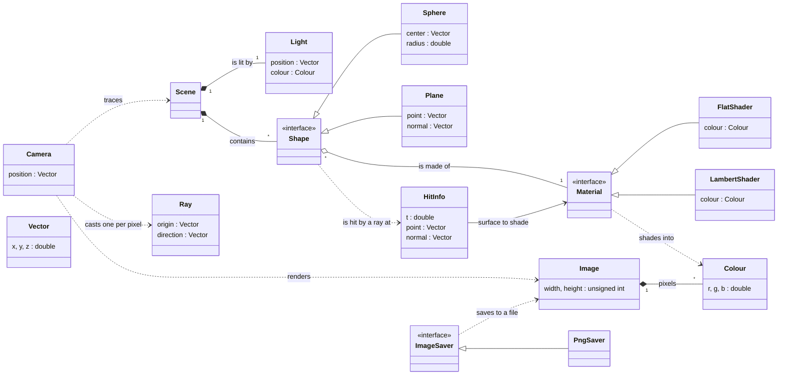

# Domain model

The concepts of the ray tracer, what each one holds, and how they are linked.
Methods are left out on purpose. Names use the client's words: scene, camera, light,
shape, material, image.

## In words

- A **scene** contains **shapes** and is lit by a **light** (a point light: a position and
  a colour).
- A **shape** is anything a ray can hit. Today that is a **sphere** or a **plane** (the
  floor). Adding a cylinder means adding one new kind of shape (ADR 7).
- Every shape **is made of** a **material**, and several shapes can share one. A material
  turns a hit and a light into a **colour**. A **flat** material always returns the same
  colour. A **Lambert** material is brighter where the surface faces the light.
- The **camera** sits at a position and looks along +z. For each pixel of the **image**,
  it casts a **ray** through the screen. The scene finds the **nearest hit** (point,
  normal, distance t, material). The hit's material gives the pixel its colour, and a
  ray that hits nothing gives black. Axes and pixel order are fixed by ADR 6.
- An **image** is a grid of colours, with (0, 0) at the top left. An **image saver**
  writes it to a file. Today the only saver is the **PNG saver** (ADR 5).
- A **vector** is a point or a direction in 3D. A **colour** has red, green and blue
  between 0 and 1. We keep them separate types, even though both hold three numbers,
  so that the compiler stops us from adding a colour to a position.

## Lifetimes

- The scene **owns** its shapes (`*--` above): they live as long as the scene.
- Materials are **shared** (`o--`): a material lives as long as the last shape that
  uses it.
- A `HitInfo` only **points** to its material. It is valid while the scene is alive,
  which is the whole render.
